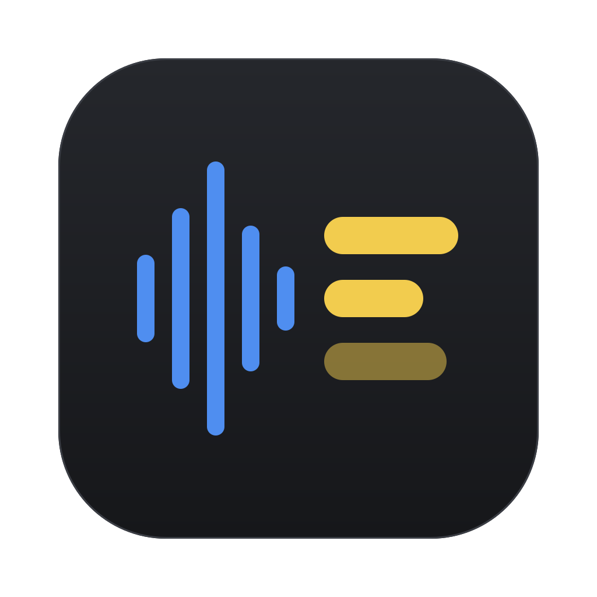
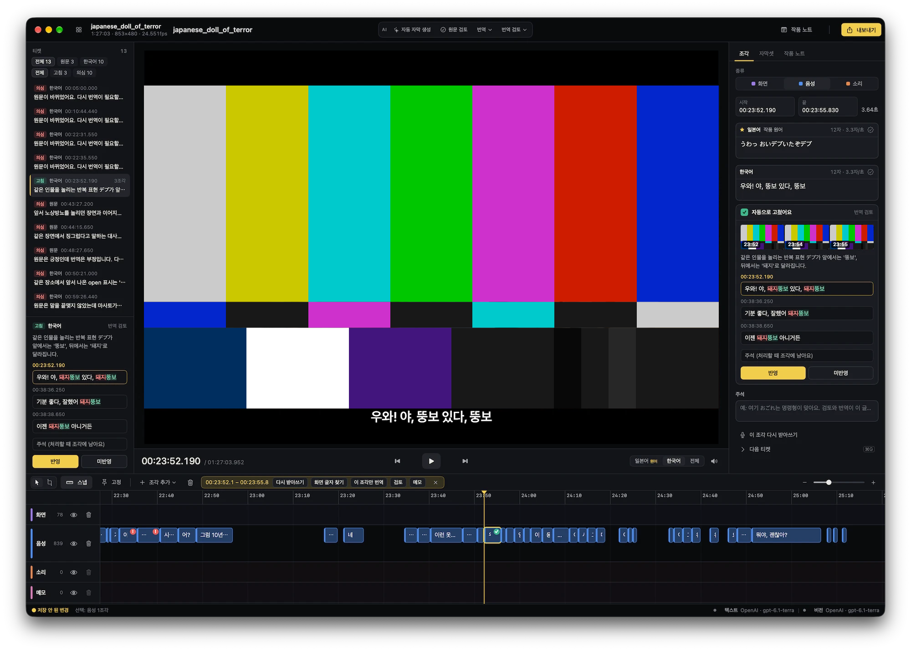

# Jamak



영상 한 편을 열어 원문 자막을 만들고, 고치고, 번역해서 내보내기까지 한 앱 안에서 끝내는 macOS 자막 편집기예요.
받아쓰기와 화면 글자 인식은 맥에서 직접 돌리고, 분석·검토·번역은 OpenAI 호환 LLM(로컬 Ollama·LM Studio 또는 외부 서비스)에 맡겨요.



## 무엇을 하나요

- **편집기**: 영상 패널, 타임라인, 자막 조각 목록이 한 화면에 있어요. 조각을 끌어 시간을 맞추고, 겹침을 표시하고, 재생 속도(1–3×)를 바꿔 가며 다듬어요.
- **자막 조각 세 종류**: 말소리, 소리(효과음), 화면 글자를 따로 다뤄요. 장면 메모 트랙도 따로 있어요.
- **원문 자막 만들기**
  - WhisperKit(large-v3)으로 받아쓰고, 단어 단위 시간으로 시작·끝을 촘촘하게 맞춰요.
  - 소리 분류로 효과음을, Apple Vision으로 화면 글자를 찾아요.
  - 구간을 골라 그 부분만 다시 받아쓰거나, 무음 판정을 끄고 "강하게 받아쓰기"를 할 수 있어요.
- **LLM 작업**
  - 작품 분석: 줄거리, 인물, 용어를 노트로 남겨요.
  - 원문 검토, 번역 검토: 결과는 티켓으로 오고, 하나씩 보고 반영하거나 넘겨요.
  - 지시 검토: 직접 쓴 지시대로 검토해요.
  - 용어집을 바탕으로 구간을 나눠 번역해요.
  - 문맥 길이와 토큰 사용량은 미터로 보여요.
- **자막셋**: 한 영상에 원문과 여러 번역 언어를 묶어 관리해요.
- **내보내기**: SRT 파일, 또는 자막 트랙을 넣은 영상(재인코딩 없이 리먹스)으로 내보내요.
- **불러오기**: mp4/mov를 열어요. MKV는 열 때 mp4로 바꿔요.

## 요구 사항

- Apple Silicon 맥, macOS 14 이상
- Xcode 16 이상(Swift 6)
- [XcodeGen](https://github.com/yonaskolb/XcodeGen): `brew install xcodegen`
- 받아쓰기 모델(WhisperKit large-v3)은 앱을 처음 쓸 때 내려받아요.
- LLM 기능을 쓰려면 OpenAI 호환 서버가 하나 필요해요. API 키는 Keychain에 저장돼요.

## 빌드

```bash
# 1. 앱에 넣을 LGPL ffmpeg를 소스에서 빌드해요(한 번만). 결과: App/Vendor/bin/ffmpeg
./scripts/build-ffmpeg.sh

# 2. Xcode 프로젝트를 만들어요(project.yml이 원본이에요)
cd App && xcodegen generate

# 3. 빌드
xcodebuild -project Jamak.xcodeproj -scheme Jamak -configuration Release -destination 'platform=macOS' build
```

빌드된 앱은 `~/Library/Developer/Xcode/DerivedData/Jamak-*/Build/Products/Release/Jamak.app`에 생겨요. `/Applications`로 복사해서 쓰면 돼요.
`Jamak.xcodeproj`는 저장소에 넣지 않아요. `project.yml`을 고친 뒤에는 `xcodegen generate`를 다시 돌려요.

## 테스트

로직은 대부분 Swift 패키지 `Packages/JamakCore`에 있고, Swift Testing으로 테스트해요.

```bash
cd Packages/JamakCore && swift test
```

테스트는 실제 LLM을 부르지 않아요. 앱에서 LLM 흐름을 손으로 확인할 때는 가짜 서버를 띄우고 그 주소를 프로바이더로 넣어요.

```bash
python3 scripts/fake-llm-server.py --port 8765
```

## 구조

```
App/                      macOS 앱(SwiftUI + AppKit)
  project.yml             XcodeGen 설정
  Design/AppIcon.svg      앱 아이콘 원본
  Jamak/                  앱 코드: 편집기 화면, 생성·LLM 작업 흐름, 설정
Packages/JamakCore/
  Sources/JamakCore/      자막 모델, 타임라인, 편집, SRT, 프로젝트 저장, LLM 파이프라인과 프롬프트
  Sources/JamakMedia/     받아쓰기(WhisperKit), 소리 분류, 화면 글자 인식, ffmpeg 실행
  Sources/JamakLLM/       OpenAI 호환 Chat Completions 클라이언트
scripts/
  build-ffmpeg.sh         동봉할 ffmpeg 빌드
  make-app-icon.swift     AppIcon.svg → 아이콘 PNG 세트
  fake-llm-server.py      수동 검증용 가짜 LLM 서버
docs/
  backlog.md              나중에 다룰 개선 후보
  images/                 README 스크린샷
  superpowers/specs/      설계 문서
  superpowers/plans/      구현 계획
```

## 아이콘 바꾸기

`App/Design/AppIcon.svg`를 고친 뒤 저장소 루트에서 아래 명령을 돌려요. `App/Jamak/Assets.xcassets/AppIcon.appiconset`의 PNG가 새로 만들어져요.

```bash
swift scripts/make-app-icon.swift
```

## 라이선스

Jamak 코드는 [MIT 라이선스](LICENSE)를 따라요.

앱에 동봉하는 ffmpeg는 별도 라이선스(LGPL)예요. GPL·nonfree 구성요소 없이 빌드했고, 고지는 [App/Jamak/Resources/LICENSE.ffmpeg.md](App/Jamak/Resources/LICENSE.ffmpeg.md)에 있어요. 받아쓰기에 쓰는 WhisperKit(argmax-oss-swift)은 MIT 라이선스예요.
